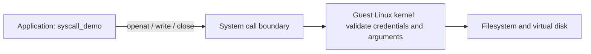
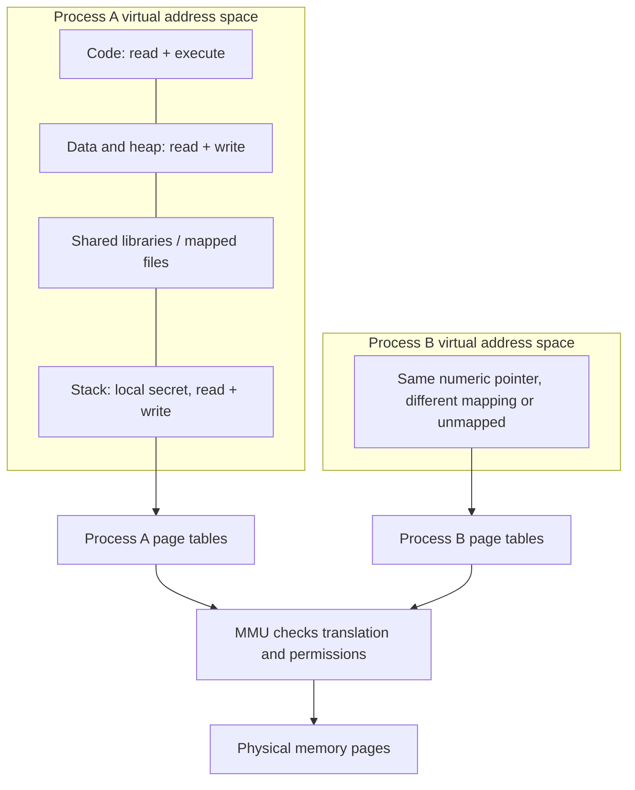
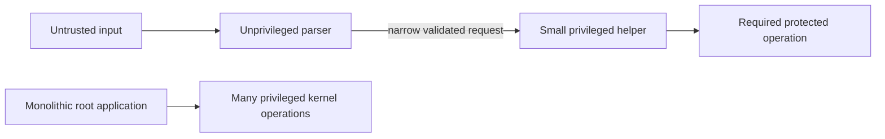
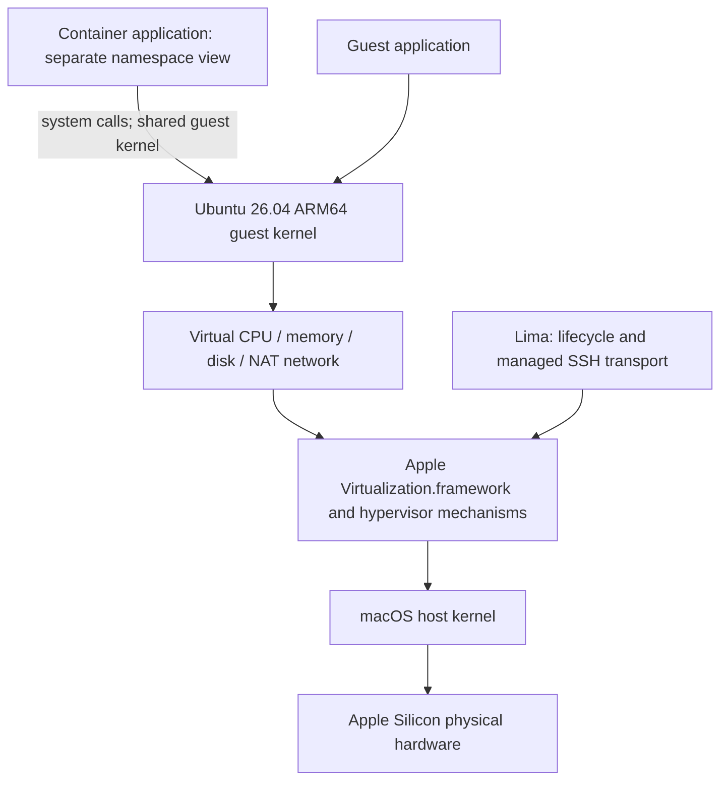

# Secure OS diagrams

These diagrams describe this project's actual architecture and experiment boundaries.

## Mission 2: kernel mediation



## Mission 4: address space



Layout is schematic. Actual mappings and permissions come from mission-04/maps.txt; addresses are architecture and run dependent.

## Mission 9: privilege separation



A Linux capability narrows classes of kernel operations; it does not automatically provide a safe request protocol or a secure parser.

## Mission 10: buffer boundary

```text
char buffer[16]: indexes 0..15
+----------------+-----------------+
| 16 valid bytes | adjacent memory |
+----------------+-----------------+
| fixed teaching input: 34 bytes   |
+----------------------------------+
                  ^ out-of-bounds writes begin here
```

A string of 15 bytes plus NUL fits. A string of 16 bytes plus NUL does not. The safe version rejects the latter before copying.

## Missions 16 and 21: actual trust stack



A container uses the guest kernel; it adds no separate kernel VM boundary. The VM has its own kernel. Lima is the management layer, not itself the hardware hypervisor. Host home directories are not mounted into the guest. No container ports are published. Management SSH forwarding is controlled by Lima and binds on the host loopback interface.
